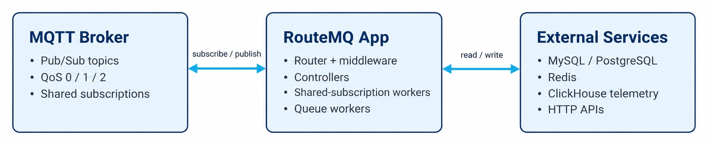

# Core Concepts

Understand the fundamental concepts and architecture of RouteMQ.

## Topics

- [Framework Architecture](architecture.md) - Overall system design
- [Router Discovery](router-discovery.md) - How routes are loaded
- [Message Flow](message-flow.md) - How messages are processed
- [Middleware Pipeline](middleware-pipeline.md) - Request processing chain
- [Worker Processes](worker-processes.md) - Shared subscriptions and scaling

## Framework Architecture

RouteMQ follows a modular architecture inspired by web frameworks:

<figure><figcaption></figcaption></figure>

## Key Components

### 1. Router Registry
- Discovers and loads route files automatically
- Manages route definitions and middleware
- Handles shared subscriptions

### 2. Middleware Pipeline
- Processes messages before reaching handlers
- Supports authentication, rate limiting, logging
- Chainable and reusable components

### 3. Controllers
- Handle business logic for routes
- Async/await support for non-blocking operations
- Direct access to Redis, database, and MQTT client

### 4. Worker Manager
- Manages shared subscription workers
- Provides horizontal scaling for high-throughput routes
- Load balancing across multiple processes

## Message Processing Flow

1. **Message Arrives**: MQTT broker receives message
2. **Route Matching**: Framework matches topic to registered routes
3. **Parameter Extraction**: Route parameters extracted from topic
4. **Middleware Chain**: Message passes through middleware pipeline
5. **Handler Execution**: Controller method processes the message
6. **Response**: Optional response published back to MQTT

## Design Principles

- **Convention over Configuration**: Sensible defaults with customization options
- **Async First**: Built for non-blocking I/O operations
- **Modular**: Loosely coupled components
- **Scalable**: Horizontal scaling through shared subscriptions
- **Testable**: Easy to unit test and mock dependencies

## Next Steps

- [Router Discovery](router-discovery.md) - Learn how routes are loaded
- [Message Flow](message-flow.md) - Understand message processing
- [Getting Started](../getting-started/README.md) - Build your first route
