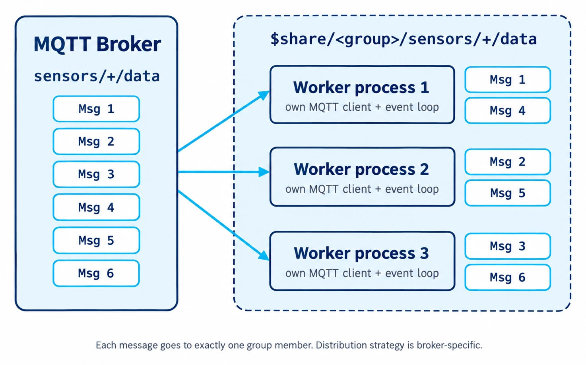

# Message Flow

Understanding how messages flow through RouteMQ from MQTT broker to your application handlers is crucial for building efficient and reliable applications.

## Complete Message Flow

<figure><figcaption></figcaption></figure>

## Step-by-Step Flow

### 1. Message Reception

The MQTT client receives a message from the broker:

```python
def _on_message(self, client, userdata, msg):
    """Callback when message received from broker"""
    topic = msg.topic
    payload = msg.payload
    
    # Handle shared subscription topic format
    if topic.startswith("$share/"):
        actual_topic = extract_actual_topic(topic)
    
    # Decode payload
    try:
        decoded_payload = json.loads(payload.decode())
    except (json.JSONDecodeError, UnicodeDecodeError):
        decoded_payload = payload
```

### 2. Route Matching

The router finds a matching route using regex patterns:

```python
async def dispatch(self, topic: str, payload: Any, client) -> None:
    """Find a matching route and dispatch the request through middleware to handler."""
    for route in self.routes:
        params = route.matches(topic)  # {} for a route without parameters
        if params is not None:
            context = {
                'topic': topic,
                'payload': payload,
                'params': params,
                'client': client,
                'correlation_id': get_correlation_id(),
                'route_pattern': route.topic,
            }

            async def execute_handler(ctx):
                return await route.handler(**ctx['params'], payload=ctx['payload'], client=ctx['client'])

            # Wrap from the inside out: the first middleware in the list runs first
            handler = execute_handler
            for middleware in reversed(route.middleware):
                handler = wrap_middleware(middleware, handler)

            return await handler(context)

    raise ValueError(f'No route found for topic: {topic}')
```

Simplified from `routemq/router.py`; tracing spans and lifecycle events are omitted.

#### Route Matching Example

```python
# Route definition
router.on("sensors/{device_id}/data/{sensor_type}", SensorController.handle_data)

# Incoming topic: "sensors/device123/data/temperature"
# Extracted params: {'device_id': 'device123', 'sensor_type': 'temperature'}
```

### 3. Parameter Extraction

Route parameters are extracted using regex groups:

```python
class Route:
    def _compile_topic_pattern(self) -> re.Pattern:
        """Convert Laravel-style params to regex"""
        pattern = self.topic
        # {device_id} becomes (?P<device_id>[^/]+)
        pattern = re.sub(r'{([^/]+)}', r'(?P<\1>[^/]+)', pattern)
        return re.compile(f'^{pattern}$')
    
    def matches(self, topic: str) -> dict[str, str] | None:
        """Extract parameters from topic"""
        match = self.pattern.match(topic)
        if match:
            return match.groupdict()  # Returns {'device_id': 'value', ...}
        return None
```

### 4. Middleware Pipeline Processing

Messages pass through middleware in the order listed on the route. `Router.dispatch` wraps the handler from the inside out, so the first middleware in the list is the outermost layer:

```python
def wrap_middleware(middleware: Middleware, next_handler: Callable) -> Callable:
    async def middleware_handler(ctx):
        return await middleware.handle(ctx, next_handler)

    return middleware_handler
```

#### Middleware Chain Example

```python
# Route with middleware
router.on("api/{endpoint}", 
          ApiController.handle,
          middleware=[AuthMiddleware(), RateLimitMiddleware(), LoggingMiddleware()])

# Execution order:
# 1. AuthMiddleware.handle()
# 2. RateLimitMiddleware.handle()  
# 3. LoggingMiddleware.handle()
# 4. ApiController.handle()
```

### 5. Controller Handler Execution

The handler receives the extracted route parameters as keyword arguments, plus the decoded payload and the MQTT client:

```python
await route.handler(**context['params'], payload=context['payload'], client=context['client'])

# Route "sensors/{device_id}/data" with topic "sensors/device123/data" calls:
await SensorController.handle_data(device_id='device123', payload={'temperature': 25.6}, client=client)
```

## Context Object

The context dictionary carries information through the middleware chain. Middleware can read and extend it; the handler itself receives only `params`, `payload`, and `client`:

```python
context = {
    'topic': 'sensors/device123/data',           # Original MQTT topic
    'payload': {'temperature': 25.6},            # Decoded JSON payload (raw bytes if not JSON)
    'params': {'device_id': 'device123'},        # Extracted route parameters
    'client': mqtt_client,                       # MQTT client for publishing
    'route_pattern': 'sensors/{device_id}/data', # Pattern of the matched route
    'correlation_id': 'b5e1...',                 # Correlation ID for logs and traces
    'observability': {...},                      # Snapshot of the observability context
    'user': user_object,                         # Example: added by an auth middleware
}
```

## Error Handling Flow

### Route Not Found

`Router.dispatch` raises `ValueError` when no route matches the topic. RouteMQ records the `router.dispatch.missed` and `mqtt.message.failed` lifecycle events, and the message is dropped.

### Middleware Stops the Chain

A middleware that returns without calling `next_handler` ends processing for that message. Later middleware and the handler never run:

```python
class AuthMiddleware(Middleware):
    async def handle(self, context, next_handler):
        if not is_authorized(context['payload']):
            return None  # The chain stops here; the handler is skipped
        return await next_handler(context)
```

### Middleware and Handler Exceptions

Exceptions are not caught inside the chain. They propagate out of `Router.dispatch`, which records the `router.dispatch.failed` and `mqtt.message.failed` lifecycle events. The `RouteMQ.Lifecycle` logger writes these events while `LOG_LIFECYCLE_EVENTS=true` (the default); shared-subscription worker processes also log the exception with its traceback.

Paho acknowledges QoS 1 and QoS 2 messages when `on_message` returns, before the handler finishes, so the broker does not redeliver a message whose handler failed. Move work that must survive failures into a [queue job](../queue/README.md) with retries.

## Async Processing

### Non-Blocking Operations

All processing is async to handle multiple messages concurrently:

```python
# Multiple messages processed simultaneously
async def handle_data(self, context):
    # Non-blocking database operation
    device = await self.db.get_device(context['params']['device_id'])
    
    # Non-blocking Redis operation  
    await self.redis.set(f"latest:{device.id}", context['payload'])
    
    # Non-blocking MQTT publish
    await self.publish(f"processed/{device.id}", {"status": "success"})
```

### Concurrent Message Handling

```python
# Framework handles multiple messages concurrently
await asyncio.gather(
    self.process_message(topic1, payload1),
    self.process_message(topic2, payload2),
    self.process_message(topic3, payload3)
)
```

## Shared Subscription Flow

For high-throughput routes with shared subscriptions, the broker delivers each message to exactly one worker process in the group:

<figure><figcaption></figcaption></figure>

### Worker Message Flow

Each worker follows the same message flow:

1. **Receive Message**: Worker gets message from shared subscription
2. **Strip Shared Prefix**: Remove `$share/group/` from topic
3. **Process Normally**: Follow standard route matching and middleware
4. **Independent Processing**: Each worker processes messages independently

## Performance Characteristics

### Throughput Optimization

* **Async Processing**: Handle multiple messages simultaneously
* **Shared Subscriptions**: Distribute load across workers
* **Middleware Caching**: Cache expensive operations in middleware
* **Connection Pooling**: Reuse database and Redis connections

### Latency Optimization

* **Direct Route Matching**: O(n) route lookup where n = number of routes
* **Minimal Middleware**: Only necessary middleware in chain
* **Async I/O**: Non-blocking external operations
* **Memory Efficiency**: Reuse context objects

## Message Flow Examples

### Simple Temperature Reading

```python
# Topic: sensors/device123/temperature
# Route: sensors/{device_id}/{sensor_type}

1. Message received: {"value": 25.6, "timestamp": "2024-01-01T12:00:00Z"}
2. Route matched: sensors/{device_id}/{sensor_type}
3. Parameters extracted: {"device_id": "device123", "sensor_type": "temperature"}
4. Middleware chain: [LoggingMiddleware]
5. Handler called: SensorController.handle_reading
6. Data stored in database
7. Alert published if threshold exceeded
```

### API Gateway Flow

```python
# Topic: api/devices/list
# Route: api/{endpoint}

1. Message received: {"user_id": "user456", "filters": {"status": "active"}}
2. Route matched: api/{endpoint}
3. Parameters extracted: {"endpoint": "devices/list"}
4. Middleware chain: [AuthMiddleware, RateLimitMiddleware, LoggingMiddleware]
5. AuthMiddleware: Validates user token
6. RateLimitMiddleware: Checks request rate
7. LoggingMiddleware: Logs request
8. Handler called: ApiController.handle_request
9. Response published to api/response/{request_id}
```

## Flow Monitoring

### Built-in Logging

```python
# Router logs
INFO: Message received on topic: sensors/device123/data
DEBUG: Route matched: sensors/{device_id}/data -> SensorController.handle_data
DEBUG: Processing through 2 middleware
INFO: Message processed successfully in 45ms

# Middleware logs  
INFO: [Auth] User authenticated: user123
INFO: [RateLimit] Request allowed: 15/100 requests
INFO: [Logging] Request ID: req_abc123
```

### Custom Monitoring

Add monitoring middleware:

```python
class MetricsMiddleware(Middleware):
    async def handle(self, context, next_handler):
        start_time = time.time()
        
        try:
            result = await next_handler(context)
            # Record success metric
            metrics.increment('messages.processed.success')
            return result
        except Exception as e:
            # Record error metric
            metrics.increment('messages.processed.error')
            raise
        finally:
            # Record processing time
            duration = time.time() - start_time
            metrics.histogram('messages.processing_time', duration)
```

## Next Steps

* [Middleware Pipeline](middleware-pipeline.md) - Implement message processing logic
* [Worker Processes](worker-processes.md) - Scale with shared subscriptions
* [Controllers](../controllers/) - Write message handlers
